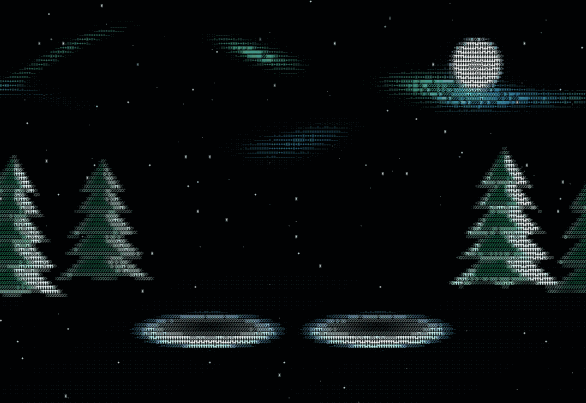
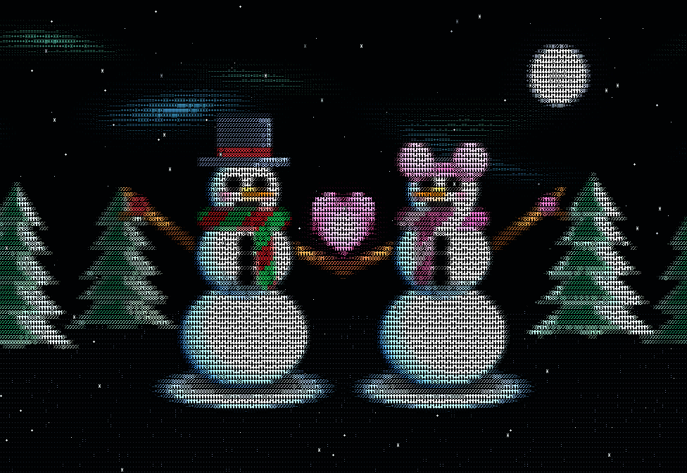

# Snow Couple — Procedural ASCII Art Animation (`aGsx`)



Pure-code procedural animated ASCII winter scene (**Snowman & Snowgirl**) built with **Python**, **NumPy**, and **Tkinter** (`96×244` character grid rendered via a `4×7` NumPy glyph-atlas at `30 FPS`) — **zero video files, images, or external media behind the code**.

Created by **Mahamad (`aGsx` / `@aGsx-bit`)**.

## Preview (Final Scene)



## Features

- **100% Pure Procedural ASCII Shader:** Signed-distance-field (SDF) snowman & snowgirl build sequence, 4 layered snowy pine trees with wind sway, drifting aurora borealis ribbons, twinkling night stars, falling snowflakes, cratered moon, and sparkling ground snow dust.
- **Smooth `30 FPS` Glyph-Atlas Engine:** Renders `23,424` colored ASCII cells (`976×672` px) directly to `tk.PhotoImage` with zero lag.
- **Interactive Controls:**
  - `R` — Restart animation from `t = 0.0`
  - `Space` — Pause / Resume without losing elapsed time
  - `A` — Jump directly to the final scene (`9.50s`)
  - `Esc` — Close window

## Quick Start

```bash
git clone https://github.com/aGsx-bit/snow-couple-ascii.git
cd snow-couple-ascii
pip install -r requirements.txt
python snow_couple.py
```

## License & Mandatory Attribution

Licensed under the [Attribution Open Source License](./LICENSE).  
**Copyright © 2026 Mahamad (`aGsx` / `@aGsx-bit`).**

Anyone using, forking, recording, sharing, or building upon this project **must visibly credit Mahamad (`aGsx` / `@aGsx-bit`)** and preserve the original [LICENSE](./LICENSE) notice.

---
*Keywords: python ascii art, procedural ascii animation, tkinter ascii animation, numpy shader, ascii snowman, creative coding python, generative art, winter ascii art, terminal style animation, aGsx*
